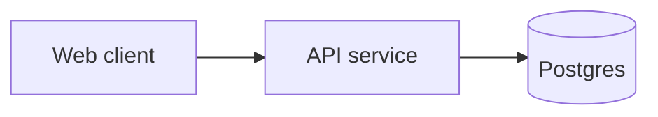

# Templates

Layout (all under `.aidlc/` at the project root):

```
.aidlc/<YYMMDD>-<label>/{requirements.md, design.md, tasks.md, state.md, audit.md, verification/, construction/, operations/, archive/}
.aidlc/codekb/<repo>/{README,overview,architecture,code-structure,technology-stack,data-model,api,interactions,conventions,operations,quality-and-risks}.md   (built by ai-dlc-codekb; templates in that skill)
.aidlc/memory/{org,team,project}.md   (approved rules only)
```

Each stage writes into a **named section** of one of the three files, using the heading `## <stage number> <Stage name>` so tools and humans can find it. A stage that is redone replaces its own section (old text is copied to `archive/<ISO-date>-<stage>.md` first). Every section ends with `### Assumptions & open questions`. Question files live next to the plan only while open: `.aidlc/<id>/questions/<stage-slug>.md` (delete or fold into the section once answered; the audit log keeps the answers).

`.aidlc/config.md` (project defaults, created on first use):
```markdown
# AI-DLC config
- Language: chat=pt-BR files=pt-BR   (asked at session start; see protocols.md §Language)
```

## Which stage writes where

| File | Sections (stage) |
|---|---|
| `requirements.md` | Original request · 1.1 Intent & stakeholders · 1.2 Market research · 1.3 Feasibility, constraints & RAID · 1.4 Scope · 1.5 Team · 1.7 Initiative brief · 2.3 Requirements (FR/NFR) · 2.4 User stories & personas |
| `design.md` | 1.6 Rough mockups · 2.1 Codebase analysis (summary + link to `codekb`) · 2.2 Team practices · 2.5 Refined mockups · 2.6 Domain & components + ADRs · 2.7 Units of work (+ dependency DAG, story map) · 2.8 Contracts · then Construction appends per Unit: 3.1 Functional design · 3.2 NFR requirements · 3.3 NFR design · 3.4 Infrastructure design |
| `tasks.md` | 2.9 Delivery plan: approved verification command, bolts, ordered tasks per Unit (checkboxes) · Construction ticks tasks and adds a status line per Unit · 3.5 code-generation summaries |
| `construction/` | 3.6 `build-and-test.md` · 3.7 `ci-pipeline.md` |
| `operations/` | 4.1 `deployment-pipeline.md` · 4.2 `environments.md` · 4.3 `deployment-log.md` · 4.4 `observability.md` · 4.5 `incident-response.md` · 4.6 `performance-validation.md` · 4.7 `feedback.md` |
| `verification/` | `phase-check-ideation.md`, `-inception.md`, `-construction.md` |

## state.md

```markdown
# AI-DLC State — <label>

- Intent: <YYMMDD>-<label>
- Status: IN_PROGRESS | PAUSED | COMPLETE | ABORTED
- Profile: <profile>   Depth: <Minimal|Standard|Comprehensive>   Tests: <level>
- Project type: greenfield | brownfield   Repos: <list>
- Switches: collaborators=<on|off> reviewers=<on|off> plan_approval=<on|off> walking_skeleton=<on|off> autonomy=<unset|gated|autonomous> iteration=<unit-major|stage-major|swarm>
- Verification command: <cmd> (approved <date>) | deferred
- Language: chat=<pt-BR|en-US> files=<pt-BR|en-US>
- Current: phase=<inception|construction|operations> stage=<N.N name>   Updated: <ISO timestamp>

## Route
Legend: [x] done · [>] current · [ ] pending · [S] skipped (reason) · [!] needs redo
### Inception
- [x] 1.1 Intent Capture
- [>] 2.3 Requirements Analysis
### Construction
- [ ] 3.5 Code Generation
### Operations
…

## Units (filled by 2.7)
| Unit | Depends on | Status | Verified |
|---|---|---|---|

## Open assumptions
- A1 (2.3): <text> — confirmed: no

## Memory candidates  (proposed, not yet approved — see protocols.md §Memory)
- C1 (gate 2.3): "Express durations in ISO-8601" — scope guess: project
```

## audit.md (append-only; newest last)

```markdown
## <ISO timestamp> — <EVENT> — <stage>
- Actor: human | ai | reviewer
- Detail: …
- Human words: "<verbatim answer/approval/change request>"
- Files: <paths>
```

Events: INTENT_CREATED, PROFILE_CONFIRMED, STAGE_STARTED, QUESTIONS_ASKED, QUESTIONS_ANSWERED, SECTION_WRITTEN, REVIEW_PASSED, REVIEW_FINDINGS, GATE_APPROVED, GATE_CHANGES_REQUESTED, STAGE_COMPLETED, STAGE_SKIPPED, STAGE_REOPENED, PLAN_APPROVED, VERIFICATION_RUN (command + exit code), UNIT_VERIFIED, FAILURE_HALT, DECISION, ASSUMPTION_CONFIRMED, STATE_REPAIRED, PHASE_CHECK, WORKFLOW_COMPLETED.

## requirements.md skeleton

```markdown
# Requirements — <intent>

## Original request
<verbatim>

## 1.1 Intent & stakeholders
## 1.4 Scope        (in / out / MVP boundary)
## 2.3 Requirements
### Functional
| ID | Requirement | Rationale | Acceptance criteria | Priority | Source |
| FR-1 | The system shall … | … | Given/When/Then | Must | [src: Q2] |
### Non-functional
| ID | Category | Measurable target | Verification | Source |
| NFR-1 | Performance | p95 < 300 ms at 200 rps | load test | [src: Q5] |
### Constraints · Out of scope · Glossary
## 2.4 User stories
### US-3 <title>  (FR-1, FR-4)  Persona: <name>
As a … I want … so that ….
- AC1: Given … When … Then …
```

## Memory files (`.aidlc/memory/{project,team,org}.md`)

```markdown
# Project memory
<!-- Approved rules only. One bullet per rule, newest last. Retire, don't delete. -->
- M-001 · 2026-10-28 · src: codekb walkthrough · Rule: Money is stored as integer cents. · Why: avoids float rounding in invoices.
- M-002 · 2026-10-30 · src: gate 2.3 · Rule: … · Why: … · (retired 2026-11-20: superseded by M-009)
```

## design.md skeleton

```markdown
# Design — <intent>

## 2.1 Codebase analysis        (brownfield: summary; details in .aidlc/codekb/<repo>/)
## 2.6 Domain & components
### Components (responsibility, interfaces, data ownership)

<caption: what the diagram shows>
### Decisions
#### ADR-4 <title>  — Status: accepted
Context · Decision · Alternatives · Consequences · Related: FR/NFR/UNIT
## 2.7 Units of work
### UNIT-2 <name>
- Purpose · Covers: US-3, FR-1, NFR-2 · Scope in/out · Interfaces · Depends on: UNIT-1
- Definition of Done: verification command passes; ACs of covered stories demonstrably met
### Dependency order  (Mermaid `flowchart LR` DAG + topological list)
### Story → Unit map  (table)
## 2.8 Contracts          (API/event/data schemas, versioning, error model)
## 3.x Per-Unit design      (appended in Construction under "### UNIT-2 — Functional design / NFR / Infra"; use `sequenceDiagram`, `erDiagram`, `stateDiagram-v2`, `flowchart` as apt)

Diagram rules: protocols.md §Diagrams.
```

## tasks.md skeleton

```markdown
# Tasks — <intent>

## 2.9 Delivery plan
- **Verification command:** `<cmd>`  (approved <date> by human)  
- Order follows the Unit DAG in design.md.
### BOLT-1 — Units: UNIT-1, UNIT-2 — Owner: <who>
Goal · Definition of Done · Confidence hypothesis · Risks/sequencing

## Tasks
### UNIT-1 <name>   Status: not started | in progress | verified (<date>, exit 0)
- [ ] T-1.1 <task>  — covers FR-1, US-3 — files: <paths> — test: <test>
- [ ] T-1.2 …
### UNIT-2 …
**Unit summary (Construction 3.5):** files changed · how to run · verification result · deviations
```

Task rules: each task is small (≤ ~1 hour of work), has an observable done-state, links to requirement/story IDs, names its test, and lives under exactly one Unit.

## Gate summary shown to the human

```
Stage 2.3 Requirements Analysis — ready for approval
Written: requirements.md § 2.3 (14 FR, 6 NFR)
Key decisions: … (≤5)
Open assumptions: A1, A2
Reviewer: PASS (1 advisory)
→ Approve / Request changes / Pause
```
